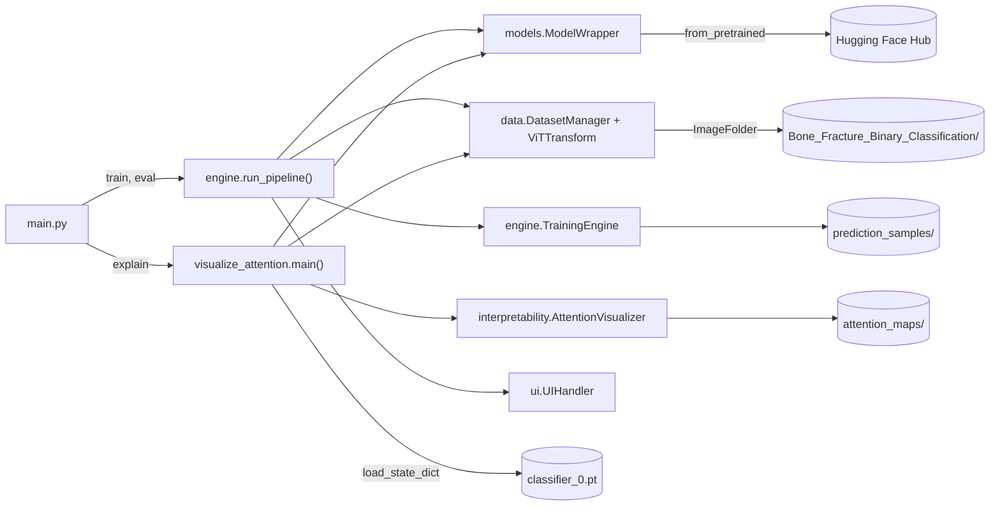
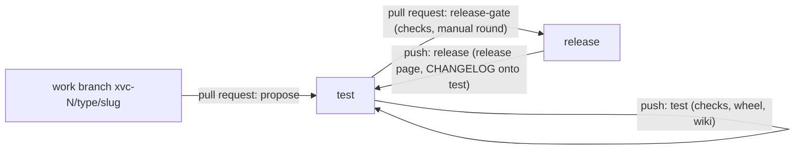

# xray-vit-classifier — documentation hub

A Python console program that takes the pretrained Vision Transformer
`google/vit-base-patch16-224`, replaces its classification head with a two-class
linear layer, trains that head on a local folder of X-ray images, prints a
classification report for the test split, and draws attention heatmaps over the
test images the model gets wrong (`src/xray_classifier/engine.py:189-226`,
`visualize_attention.py:16-39`). The task is binary bone-fracture classification
(`pyproject.toml:17`, `recipe.ps1:14`). Who the users are is not stated (see
[Open questions in SPEC.md](../SPEC.md#9-open-questions)).

## Status

| Item | Value | Source |
| --- | --- | --- |
| Branch | `xvc-60/docs/spec-md`, the branch of pull request #2 into `test`; its task list is Jira ticket KAN-60 | `git status -sb`, `gh pr list --head xvc-60/docs/spec-md` |
| Last commit | `75d38b5`, 2026-11-17 21:19 +0200, "docs(spec): add SPEC.md mirrored as Jira KAN-60", one commit ahead of `origin/test` (`42206b3`) | `git log -1`, `git rev-list --count origin/test..HEAD` |
| Version | `1.1.0` in the recipe and in the packaging metadata (`recipe.ps1 test` fails when they differ), `0.1.0` in the package itself. Tag `v1.1.0` is on `release` only | `recipe.ps1:13`, `pyproject.toml:16`, `src/xray_classifier/__init__.py:3`, `git branch -r --contains v1.1.0` |
| Tests | 6 in `tests/` (3 unit tests, 1 offline check, 2 checks of the manual list), 4 benchmark cases, 0 manual tests | `tests/*.py`, `benchmarks/test_preprocessing_performance.py`, `tests/manual/tests.json:3` |
| CI | Five Gitea workflows: `propose`, `test`, `release-gate`, `release`, `sweep`, all on a `windows` runner | `.gitea/workflows/*.yaml` |
| Tasks to do | 4 in Jira KAN-60 when this was written: the first four rows of [SPEC.md §3.11](../SPEC.md#311-declared-but-not-implemented). The other 9 rows there are document claims the code does not back | `SPEC.md` |
| TODO / FIXME tags | 0 in code; `tools/wiki.py:32` names those spellings in a comment | `git grep` |

The last commit's subject uses the scope `spec`, which `$CommitScopes`
(`recipe.ps1:22`) does not list. The `commit-msg` hook
(`.claude/hooks/git/commit-msg.ps1:37-47`) and the commit wording check of the
`propose` gate (`.gitea/workflows/propose.yaml:77-142`) refuse such a subject.
Whether a gate has run on this pull request was not checked.

What is evidently unfinished; each item is a KAN-60 task to do:

- `main.py` parses `--epochs`, `--batch-size`, `--weights` and `--count`, but
  never passes them on. Three comments say so: "Pipeline currently does 1 epoch
  and eval" (`main.py:49`), "Logic to be refined in engine.py for pure
  evaluation" (`main.py:52`), "Will bridge to visualize_attention logic"
  (`main.py:56`). `docs/manual.md:17-24` lists the four options as accepted and
  not acted on.
- Trained weights are never written to disk. `ModelWrapper.save` exists
  (`src/xray_classifier/models.py:56-58`), but nothing calls it.
- No test drives `TrainingEngine` or `AttentionVisualizer`, and the coverage
  floor is 9 % (`pyproject.toml:107-108`).
- `scripts/profile_application.py` imports `quality_template.core`, which does
  not exist in this repository. Running it fails with `ModuleNotFoundError`
  (checked, see [About this document](#about-this-document)).

Branch state at the time of writing: `origin/test` (`42206b3`) and
`origin/release` (`7c56d4d`) are each one commit ahead of the other. `release`
holds the merge of pull request #22 from `test`, which carries tag `v1.1.0`;
`test` holds the changelog commit that the release workflow wrote onto it
(FR-58 in SPEC.md). `origin/dev` ends at `69fa999`, which is tagged
`import/dev` (`docs/branching.md:14`). The code under `main.py`,
`visualize_attention.py`, `src/` and `benchmarks/` is the same on `dev` and on
this branch. The tooling is not: commit `8db1bde` removed `dev`'s
`.github/workflows/`, `Makefile`, `.pre-commit-config.yaml` and three helper
scripts, and the later commits added `recipe.ps1`, `.gitea/`, `.claude/` and
`CLAUDE.md` (`git diff --stat origin/dev HEAD`, `git show --stat 8db1bde`).

## Layout

| Path | Content |
| --- | --- |
| `main.py` | CLI entry point: `train`, `eval`, `explain` subcommands (argparse) |
| `visualize_attention.py` | Attention-map run used by `explain`; holds the model name, weights path and data root as constants |
| `src/xray_classifier/data.py` | `DataProvider` protocol, `ViTTransform`, `DatasetManager` (train/val/test `ImageFolder` loaders) |
| `src/xray_classifier/models.py` | `ImageClassifier` protocol, `ModelWrapper` (pretrained ViT, new 2-class head, frozen backbone) |
| `src/xray_classifier/engine.py` | `TrainingEngine` (train, validate, evaluate, save sample images) and `run_pipeline()` |
| `src/xray_classifier/interpretability.py` | `AttentionVisualizer`: CLS-token attention heatmaps for misclassified test images |
| `src/xray_classifier/ui.py` | `UIHandler`: rich console, logging handler, tables, progress bar |
| `recipe.ps1` | The verbs `build`, `install`, `uninstall`, `clean`, `run`, `publish`, `info`, `test`, and the metadata the hooks and workflows read |
| `tests/test_core.py` | Unit tests for the transform, the model head and the dataset path |
| `tests/conftest.py`, `tests/test_no_weights_are_downloaded.py` | Hugging Face Hub offline for the whole run, and the test that asserts it |
| `tests/test_manual_list.py`, `tests/manual/` | The manual test list (`tests.json`, empty), its page (`index.html`) and the local server for it (`serve.py`) |
| `benchmarks/test_preprocessing_performance.py` | pytest-benchmark cases for `ViTTransform` |
| `scripts/` | `build_release_artifact.py` (wheel, sdist, checksums), `collect_quality_metrics.py` (ISO 25010 numbers), `profile_application.py` (fails on import) |
| `tools/wiki.py` | Wiki generator, vendored from another lab repository (`tools/wiki.py:1`) |
| `.gitea/workflows/` | `propose.yaml`, `test.yaml`, `release-gate.yaml`, `release.yaml`, `sweep.yaml` |
| `.gitea/issue_template.md`, `.gitea/pull_request_template.md` | Issue and pull request templates |
| `.claude/` | `settings.json` (Claude Code hooks), `hooks/` (gate, event log, session start), `hooks/git/` (`commit-msg`, `pre-push`), `skills/lab-ai-env/` |
| `CLAUDE.md` | The repository's rules file |
| `prediction_samples/`, `attention_maps/`, `docs/assets/` | Committed output images, stored through Git LFS (`.gitattributes:9`). `README.md:26` refers to the first two; no document references `docs/assets/` |
| `docs/` | Install and manual pages, architecture, ISO 25010 assessment, branching, ADR-001, this hub |
| `pyproject.toml`, `uv.lock`, `.gitattributes`, `.gitignore` | Packaging and tool settings, lock file, line endings and LFS, ignores |

The dataset folder `Bone_Fracture_Binary_Classification/` and all `*.pt` weight
files are git-ignored (`.gitignore:26-30`) and not part of the repository.

## Architecture

Two runs share the same model and data classes. `train` and `eval` both call
`run_pipeline()` (`main.py:47-53`); `explain` imports `visualize_attention.main`
(`main.py:54-60`). The only external service of the program is the Hugging Face
Hub: `ModelWrapper` calls `from_pretrained("google/vit-base-patch16-224")` for
the processor and the model (`src/xray_classifier/models.py:32-35`), and
`transformers` downloads them when no local copy is cached (library behaviour,
`docs/install.md:9`). Everything else is local files. The code selects CUDA
when available, otherwise the CPU (`src/xray_classifier/engine.py:38`,
`interpretability.py:33`, `visualize_attention.py:19`); on Windows the locked
`torch` is the CPU build (`docs/install.md:7`).



Data flow of `run_pipeline()` (`src/xray_classifier/engine.py:189-226`):
environment panel → load model → load the three splits with batch size 32 →
dataset statistics table → one epoch of Adam (lr 0.001) on the head parameters
with cross-entropy loss → validation loss → test-set classification report and
up to six annotated sample images in `prediction_samples/`.

Data flow of `explain` (`visualize_attention.py:16-39`,
`src/xray_classifier/interpretability.py:35-121`): load `classifier_0.pt` →
test split with batch size 1 → predict every test image → for up to 10
misclassified ones, average the last layer's attention over heads, take the
CLS-to-patch row as a 14 × 14 grid, upsample it to the image size and save a
two-panel figure.

The `ImageClassifier` and `DataProvider` protocols (`models.py:9-17`,
`data.py:14-23`) type the engine's and visualizer's constructor arguments.
`run_pipeline()` and `visualize_attention.py` still construct `ModelWrapper` and
`DatasetManager` directly. The engine and visualizer read `outputs.logits`,
`outputs.attentions` and `dataset.samples`, which are attributes of the
`transformers` output object and of torchvision `ImageFolder`
(`engine.py:134,147-149`, `interpretability.py:53,73,79`).

Around the program, `recipe.ps1` is the one entry point for running, building
and testing, and the Gitea workflows call its verbs. Changes move from a work
branch into `test` and from `test` into `release`, each by a pull request that
a workflow checks (`docs/branching.md:5-10`, SPEC.md §3.9):



## Build and run

Prerequisites:

| Requirement | Value | Source |
| --- | --- | --- |
| Python | `>=3.13,<3.14`; the lock file is resolved for 3.13 only | `pyproject.toml:21`, `uv.lock:3`, `docs/install.md:3` |
| uv | Runs every Python step of the recipe | `docs/install.md:3`, `recipe.ps1:49,63,103-110` |
| Git LFS | The committed PNG images are stored in it | `docs/install.md:4`, `.gitattributes:9` |
| Runtime packages | torch, torchvision, transformers, datasets, scikit-learn, rich, pillow, matplotlib, each pinned with `==` (versions in [SPEC.md §7](../SPEC.md#7-constraints-and-dependencies)) | `pyproject.toml:22-34` |
| GPU | Optional; CUDA is used when `torch.cuda.is_available()`. On Windows the locked `torch` is the CPU build | `src/xray_classifier/engine.py:38`, `docs/install.md:7` |
| Dataset | `Bone_Fracture_Binary_Classification/{train,val,test}/<class>/<images>` at the repository root | `engine.py:208`, `data.py:72-78`, `visualize_attention.py:13`, `docs/install.md:11` |
| Network | Hugging Face Hub, for the first model download | `models.py:32-35`, `docs/install.md:9` |

Where the dataset comes from is not documented in this tree.

Install (`docs/install.md:1-5`):

```powershell
uv sync --frozen
```

`[tool.uv] package = false` keeps uv from installing the project itself
(`pyproject.toml:57-59`). `main.py` imports `xray_classifier` (`main.py:7`),
which lives under `src/`, so `recipe.ps1 run` puts `src` on `PYTHONPATH`
before it starts `main.py` (`recipe.ps1:60-63`).

Run (`README.md:9-12`, `docs/manual.md:3-7`, arguments from `main.py:16-41`):

```powershell
.\recipe.ps1 run train
.\recipe.ps1 run eval
.\recipe.ps1 run explain
```

Build:

```powershell
.\recipe.ps1 build                                          # a wheel in dist\       (recipe.ps1:48-51)
python scripts/build_release_artifact.py --version v1.1.0   # wheel, sdist, .sha256 under release\ (scripts/build_release_artifact.py:3)
```

The second command needs the `build` package, the `release` extra
(`pyproject.toml:36-38`); without it the script stops and says so
(`scripts/build_release_artifact.py:39-43`). The wheel carries only
`src/xray_classifier`; `main.py` is not in it (`docs/install.md:13`).

## Configuration

The program (`main.py`, `visualize_attention.py`, `src/`) reads no environment
variables and no configuration file. Its behaviour is set by CLI arguments and
by constants in the code. The tooling reads these environment variables, by
name only here:

| Variable | Read by | Source |
| --- | --- | --- |
| any `NAME=value` in `.claude/.env` (git-ignored) | `recipe.ps1`, before every verb; a variable already set wins | `recipe.ps1:34-43`, `.gitignore:24` |
| `LAB_SHARE` | `recipe.ps1 publish`, the folder the wheel goes to | `recipe.ps1:66-75` |
| `HF_HUB_OFFLINE` | set to `1` by `recipe.ps1 test` and `tests/conftest.py`; read by `huggingface_hub` | `recipe.ps1:101`, `tests/conftest.py:6` |
| `GITEA_TOKEN` | `tests/manual/serve.py`, from the environment or `.claude/.env` | `tests/manual/serve.py:52-62` |
| `LAB_BOT_TOKEN`, `TOKEN` | `tools/wiki.py --push`, when `--token` is not given; the workflows pass the secret `LAB_BOT_TOKEN` | `tools/wiki.py:400`, `.gitea/workflows/test.yaml:24-25` |

CLI arguments of `main.py`:

| Subcommand | Argument | Default | Effect in the code | Source |
| --- | --- | --- | --- | --- |
| `train` | `--epochs` | `1` | Only printed in the log line; training always runs 1 epoch | `main.py:23-25,48`; `engine.py:218` |
| `train` | `--batch-size` | `32` | Not used; loaders use the default 32 | `main.py:26`; `data.py:62`; `engine.py:209` |
| `eval` | `--weights` | `classifier_0.pt` | Only printed; `eval` runs the same training pipeline as `train` | `main.py:30-32,51-53` |
| `explain` | `--weights` | `classifier_0.pt` | Only printed; the path comes from `WEIGHTS_PATH` | `main.py:36-38,55`; `visualize_attention.py:12` |
| `explain` | `--count` | `10` | Only printed; the count is fixed at 10 | `main.py:39-41,55`; `visualize_attention.py:39` |

Constants:

| Name / place | Value | Source |
| --- | --- | --- |
| Model id | `google/vit-base-patch16-224` | `engine.py:203`, `visualize_attention.py:11` |
| Data root | `Bone_Fracture_Binary_Classification` | `engine.py:208`, `visualize_attention.py:13` |
| Weights file for `explain` | `classifier_0.pt` | `visualize_attention.py:12` |
| Optimizer | Adam, lr 0.001, head parameters only | `engine.py:215` |
| Loss | `nn.CrossEntropyLoss` | `engine.py:214` |
| Number of labels | 2 | `models.py:27` |
| Sample output directory | `prediction_samples` (deleted and recreated on every run) | `engine.py:26,43-49` |
| Attention output directory | `attention_maps` (created if missing, not cleaned) | `interpretability.py:26,31-32` |
| Test batch size for `explain` | 1 | `visualize_attention.py:35` |

Tool configuration: ruff (version 0.16.1, line length 100, target py313, rule
sets in `pyproject.toml:61-98`), mypy strict (`pyproject.toml:118-130`), pytest
and coverage (`pyproject.toml:103-116`). The recipe's metadata, such as the
project code and the commit and branch vocabularies, is in `recipe.ps1:9-25`.

Helper-script flags (the first three confirmed with `--help`):

| Script | Flags |
| --- | --- |
| `scripts/build_release_artifact.py` | `--version` (default `v0.0.0-dev`, log only), `--skip-verify` |
| `scripts/collect_quality_metrics.py` | `--output OUTPUT`, `--fail-under FAIL_UNDER` |
| `tools/wiki.py` | `--push`, `--wiki-url`, `--token`, `--sha`, `--out` |
| `tests/manual/serve.py` | none; serves `http://127.0.0.1:8765/` (`tests/manual/serve.py:3,23`) |
| `scripts/profile_application.py` | fails on import (see Status) |

## Usage

Train the head and evaluate it on the test split, with the dataset in place:

```powershell
.\recipe.ps1 run train
```

The console shows an "Environment" panel with CUDA ON/OFF and the device, a
"Dataset Statistics" table (Training / Validation / Test counts), a progress
bar, one line `Epoch 0 | Train Loss: … | Val Loss: …` and a "Final Metrics"
table with precision, recall, F1 and support per class plus accuracy
(`engine.py:194-226`, `ui.py:38-69`). `prediction_samples/` is emptied and
receives up to three `correct_{i}.png` and three `incorrect_{i}.png`, each with
the true and predicted class drawn on the image (`engine.py:142-186`). The
trained head is not saved.

`.\recipe.ps1 run eval` runs the same pipeline; only its first log line differs
(`main.py:50-53`, `docs/manual.md:12`).

Draw attention maps for misclassified test images:

```powershell
.\recipe.ps1 run explain
```

This needs `classifier_0.pt` at the repository root, holding a state dict for
the full `ViTForImageClassification` with a 2-class head
(`visualize_attention.py:24-27`, `docs/manual.md:13,26`). If the file cannot be
loaded, the program logs `Could not load weights from classifier_0.pt: <error>`
and stops (`visualize_attention.py:28-30`). Otherwise it writes up to ten files
`attention_maps/error_{index}_t{true}_p{pred}.png` (`interpretability.py:119`).
The images committed in `attention_maps/` use a different name pattern
(`error_1_true_0_pred_1.png`). That is the pattern of an earlier version of the
code: `visualize_attention.py:115` at commit `e144bab` wrote
`error_{i}_true_{label}_pred_{...}.png`, and commit `f36f1f3` changed it.

Measure the ISO 25010 indicators and benchmark preprocessing:

```powershell
python scripts/collect_quality_metrics.py --output quality-report.json   # docs/quality-iso25010.md:11
pytest benchmarks --benchmark-only                                       # benchmarks/test_preprocessing_performance.py:12
```

The metrics script calls `pytest`, `radon` and `ruff` through the interpreter
it runs under (`scripts/collect_quality_metrics.py:59,102-104`), so that
interpreter needs the dev group (`pyproject.toml:40-52`).

Run the manual tests before a release, when `tests/manual/tests.json` lists any
(it lists none now):

```powershell
python tests/manual/serve.py   # then open http://127.0.0.1:8765/   (.gitea/workflows/release-gate.yaml:204-215)
```

`.\recipe.ps1 test` points git at the hooks in `.claude/hooks/git`
(`recipe.ps1:97-99`), and so does the Claude Code session start
(`.claude/hooks/session-start-stop.ps1:31-36`). From then on `commit-msg`
checks each commit's subject and sign-off, and `pre-push` checks branch names
and pushes to `release` (SPEC.md FR-60, FR-61).

## Testing

| Command | What it runs | Source |
| --- | --- | --- |
| `.\recipe.ps1 test` | Version check, git hooks path, then pytest (the 6 tests in `tests/`, coverage floor 9 %), mypy, ruff check, ruff format in place | `recipe.ps1:84-113` |
| `uv run --frozen python -m pytest` | The pytest step alone; `testpaths` limits it to `tests/` | `recipe.ps1:103`, `pyproject.toml:103-108` |
| `pytest benchmarks --benchmark-only` | The 4 benchmark cases | `benchmarks/test_preprocessing_performance.py:12` |
| `propose`, `test`, `release-gate` workflows | `.\recipe.ps1 test`, then `git diff --exit-code` | `.gitea/workflows/propose.yaml:144-152`, `test.yaml:54-58`, `release-gate.yaml:49-53` |

`pyproject.toml:104` sets `testpaths = ["tests"]`, so a plain pytest run
collects 6 tests and leaves `benchmarks/` out. The "7 tests" in
`docs/quality-iso25010.md:18` match `dev`, which had 3 unit tests, no
`testpaths`, and the 4 benchmark cases (inference).

What the tests cover:

- `test_vit_transform_rgb`: a grayscale image goes through `ViTTransform` with a
  mocked processor and comes out as a `(3, 224, 224)` tensor
  (`tests/test_core.py:25-37`).
- `test_model_wrapper_initialization`: with both `from_pretrained` calls
  patched, the model one returning a small `ViTConfig` model, both calls receive
  the model id (the model call also `output_attentions=True`), and `ModelWrapper`
  ends with a head of 2 outputs and only `classifier.weight` and
  `classifier.bias` trainable
  (`tests/test_core.py:11-22,40-57`). It needs no network.
- `test_dataset_manager_paths`: `DatasetManager` stores its root as a `Path`
  (`tests/test_core.py:60-63`).
- `test_the_hub_is_offline_for_the_whole_run`: `HF_HUB_OFFLINE` is in force
  (`tests/test_no_weights_are_downloaded.py:6-7`).
- `test_the_list_has_a_known_shape`, `test_every_entry_is_complete`:
  `tests/manual/tests.json` is well-formed (`tests/test_manual_list.py:30-51`).
- Benchmarks: `ViTTransform` on 64/256/1024-pixel grayscale and 256-pixel RGB
  images, with the processor mocked
  (`benchmarks/test_preprocessing_performance.py:28-57`).

Not covered by any test: `engine.py`, `interpretability.py`, `ui.py`, `main.py`,
`visualize_attention.py`, `scripts/` and `tools/`. No test imports them. No
manual tests are defined (`tests/manual/tests.json:3`), so `release-gate` passes
the manual round as "no manual tests defined"
(`.gitea/workflows/release-gate.yaml:139-150`).

## Known limitations and problems

Behaviour:

1. The CLI arguments have no effect (see [Configuration](#configuration)).
2. `eval` retrains a new head instead of loading weights (`main.py:50-53`).
3. No run writes weights, yet `explain` requires `classifier_0.pt`
   (`models.py:56-58` has no caller; `visualize_attention.py:12,24-30`).
   Earlier versions wrote it; commit `f36f1f3` removed the save (see
   [SPEC.md §9](../SPEC.md#9-open-questions), question 3).
   `CHANGELOG.md:71` says a file `xray_vit_classifier_v0.1.0.pt` was a GitHub
   Release asset. Whether the asset exists was not checked.
4. Every `train`/`eval` run deletes the whole `prediction_samples/` directory,
   including the committed images that `README.md:26` presents as the recorded
   run's results (`engine.py:43-49`).
5. The training loss that gets reported is the mean of the last completed block
   of 20 batches. With fewer than 20 training batches it is printed as `0.0000`,
   and batches after the last full block are left out (`engine.py:70-92`). An
   empty validation loader is likewise reported as loss `0.0` (`engine.py:112`).
6. `explain` catches only `ImportError` (`main.py:57-62`). The attention grid is
   fixed at 14 × 14 (`interpretability.py:89`), and min-max normalisation
   divides by `max - min` (`interpretability.py:90`). A uniform attention map
   would therefore produce NaN values (inference).
7. `evaluate_and_sample` locates sample files through `dataset.samples` and the
   batch index, which relies on the unshuffled `ImageFolder` test loader
   (`engine.py:147-149`, `data.py:85`).

Packaging and tooling:

8. `datasets` is declared (`pyproject.toml:28`), but no module imports it.
   `huggingface_hub` is imported by `tests/test_no_weights_are_downloaded.py:3`
   and not declared; `uv.lock` has it only as a dependency of `transformers`,
   `datasets` and `tokenizers`.
9. The versions disagree: `1.1.0` (`recipe.ps1:13`, `pyproject.toml:16`)
   against `0.1.0` (`src/xray_classifier/__init__.py:3`).
10. The wheel contains only `src/xray_classifier` (`pyproject.toml:54-55`,
    `recipe.ps1:19`). `main.py` and `visualize_attention.py` sit at the
    repository root, and `pyproject.toml` declares no console script, although
    `build_release_artifact.py:12-13` mentions a "console entry point".
11. The `release` workflow attaches no wheel to the release page: it attaches
    an installer `.exe` only if `dist\` holds one, plus `manual-report.md` and
    `sbom.md` (`.gitea/workflows/release.yaml:296-336`). `recipe.ps1 build`
    makes only a wheel (`recipe.ps1:48-51`).
12. Ruff's rule selection does not include `F` (pyflakes)
    (`pyproject.toml:69-84`), so unused imports such as `Path` in `main.py:3`
    are not reported.
13. Every workflow runs on Windows with Python 3.13 only (`runs-on: windows` in
    `.gitea/workflows/*.yaml`, `pyproject.toml:21`).

Existing documents that disagree with the code (left unchanged; listed here so
a reader knows):

14. `docs/architecture.md:10` and `CHANGELOG.md:65` mention FP16 / half
    precision. The code contains no `half()` or `autocast`.
    `docs/architecture.md:11` says the UI shows GPU memory; the panel shows
    only CUDA ON/OFF and the device type, `cuda` or `cpu` (`engine.py:194-200`).
15. `docs/quality-iso25010.md` reports a run of 2026-08-05 (`:14-21`), before
    this tree: "7 tests" against 6 now, "83.5 % branch coverage" against a
    floor of 9 % that `pyproject.toml:107` calls what the suite measures, CI on
    "ubuntu-latest with Python 3.10 only" (`:135-137`) against Windows and 3.13
    here, a permissive `torch>=2.0` range (`:70-73`) against `torch==2.11.0`
    (`pyproject.toml:25`), and a scheduled `secret-scan` workflow (`:106-108`)
    that commit `8db1bde` deleted.
16. `docs/quality-iso25010.md:52-53` says the benchmarked transform cost is
    "driven by resizing". The benchmark mocks the processor, so no resizing
    takes place in it (`benchmarks/test_preprocessing_performance.py:28-36`).
    `docs/quality-iso25010.md:94-96` places uncovered branches in
    `engine.evaluate_and_sample`. No test imports `engine.py`.
17. A comment in `scripts/collect_quality_metrics.py:147-149` calls the
    pipeline `python-ci.yml`; the code under it reads `.gitea/workflows/`
    (`:150-155`).
18. `CONTRIBUTING.md:14` points to `BEST_REQUIREMENTS.md`, which is not in this
    repository; `README.md:42` links it on a server at a local address.
    `SECURITY.md:28-29` asks for a committed `.env.example`; there is none.
19. The accuracy table in `README.md:20-26` (83 %) cannot be reproduced from
    the repository. `README.md:18` calls it one run recorded before the lab,
    and no script or result file records how it was obtained.

## Related documents

- [../README.md](../README.md) — project README
- [../SPEC.md](../SPEC.md) — requirements specification reverse-engineered from the code, with the task list mirrored as Jira KAN-60
- [install.md](install.md) — what to install and where the dataset goes
- [manual.md](manual.md) — the commands and which options they do not read yet
- [architecture.md](architecture.md) — ISO 25010 mapping and component diagram
- [quality-iso25010.md](quality-iso25010.md) — measured and assessed quality characteristics
- [branching.md](branching.md) — the two long-lived branches and what became of the old ones
- [adr/ADR-001-Model-Selection.md](adr/ADR-001-Model-Selection.md) — why ViT-base was chosen
- [../CLAUDE.md](../CLAUDE.md), [../CONTRIBUTING.md](../CONTRIBUTING.md), [../SECURITY.md](../SECURITY.md), [../CHANGELOG.md](../CHANGELOG.md), [../LICENSE](../LICENSE) (Apache 2.0)

## About this document

First written 2026-11-18 from commit `69fa999` (branch `dev`), together with
the specification that [SPEC.md](../SPEC.md) now contains. Corrected on
2026-11-20 for branch `xvc-60/docs/spec-md` at `75d38b5`, together with the
merged SPEC.md. Every statement cites the file it was taken from. Statements
marked "inference" are conclusions drawn from the cited evidence.

Commands run to check it:

- `git status`, `git log`, `git ls-files`, `git branch -a`, `git tag`,
  `git rev-list --count`, `git merge-base --is-ancestor`,
  `git branch -r --contains`, `git diff --stat origin/dev HEAD`,
  `git show` and `git grep` (read-only).
- With Python 3.13.3: `python -B <script> --help` for
  `scripts/build_release_artifact.py`, `scripts/collect_quality_metrics.py` and
  `tools/wiki.py`, which printed their usage, and `python -B
  scripts/profile_application.py --help`, which failed with
  `ModuleNotFoundError: No module named 'quality_template'` at line 22.

Not run: `recipe.ps1` (any verb), `main.py`, `pytest`, the benchmarks, `ruff`,
`mypy`, `uv sync`, the release build and the workflows. Installing the locked
dependencies was out of scope. The one network call was a read-only
`gh pr list`, which showed pull request #2 open from this branch into `test`.
The Hugging Face model download, the GitHub Release assets and the Gitea runs
were not checked.
